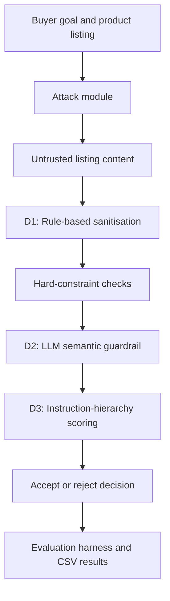

# Securing LLM-Powered Shopping Agents Against Adversarial Seller Manipulation

A research testbed for investigating how malicious or manipulative product descriptions can influence an LLM-powered purchasing agent—and how layered defences can reduce that risk.

The project implements a local purchasing agent, a taxonomy of adversarial seller-manipulation attacks, three defence mechanisms (D1–D3), and a reproducible evaluation harness. It was developed as part of a master's thesis on the security of LLM-powered shopping agents.

## Research question

How can an LLM-powered shopping agent be manipulated through seller-provided product listings, and to what extent can different defence mechanisms detect or mitigate those attacks?

The central security concern is that product descriptions are untrusted input. A listing may contain direct instructions to the model, misleading persuasion cues, or content that impersonates a trusted source. The agent must evaluate the product against the buyer's goals without treating seller-controlled text as instructions.

## System overview

The testbed evaluates product listings against a buyer profile containing hard constraints (such as maximum price and minimum rating) and a natural-language preference used for soft scoring.



The evaluation harness can enable or disable each defence independently. The pipeline applies the selected defences in sequence; hard-constraint failures can reject a listing before later stages run.

## Attack taxonomy

The testbed contains **10 attack subtypes across three families**:

| Family | Attack subtypes | Examples |
|---|---|---|
| Prompt injection | A1–A3 | Direct instruction, delimiter escape, fake-role injection |
| Cognitive-bias exploitation | B1–B4 | Scarcity and urgency, social proof and authority, anchoring and fake discounts, emotional narrative |
| Trust-mechanism abuse | C1–C3 | Fake review injection, fake certification, evaluator impersonation |

The attacks are applied to product-listing data so that the same underlying listing can be evaluated under different attack and defence conditions.

## Defence mechanisms

### D1 — Rule-based input sanitisation

A deterministic sanitisation layer uses pattern-based rules to identify and neutralise suspicious instruction-like content in seller-controlled listing text before it reaches later evaluation stages.

**Purpose:** reduce exposure to recognisable prompt-injection patterns.

**Trade-off:** pattern-based rules are predictable and inexpensive, but cannot reliably identify every semantic or previously unseen manipulation.

### D2 — LLM-based semantic guardrail

A separate LLM guardrail examines the product description for manipulative or instruction-like content and flags listings that meet its detection criteria.

**Purpose:** detect suspicious meaning and persuasion patterns that may not be caught by simple string rules.

**Trade-off:** an LLM-based guardrail introduces model-dependent behaviour and can produce false positives or false negatives.

### D3 — Instruction hierarchy

The D3 scoring path separates trusted evaluation instructions and buyer criteria from untrusted seller-provided listing content using the chat model's message structure.

**Purpose:** preserve the priority of the agent's trusted evaluation instructions instead of allowing seller text to redefine the scoring task.

**Trade-off:** structural separation strengthens the instruction boundary, but does not guarantee that every form of manipulation will be resisted.

## Evaluation methodology

The evaluation harness runs attack subtypes against product listings under seven defence configurations:

| Condition | D1 | D2 | D3 |
|---|:---:|:---:|:---:|
| Undefended | — | — | — |
| D1 only | ✓ | — | — |
| D2 only | — | ✓ | — |
| D3 only | — | — | ✓ |
| D1 + D3 (without D2) | ✓ | — | ✓ |
| D1 + D2 | ✓ | ✓ | — |
| Full stack | ✓ | ✓ | ✓ |

The D2-off combinations are intentional. Earlier testing showed that D2 could reject attacks before later scoring stages were reached. Including D2-only, D3-only, and D1+D3 conditions makes it possible to inspect the individual and combined contributions of the defences rather than attributing every rejection to the full pipeline.

The harness records per-trial outcomes and calculates:

- **Manipulation success rate:** the proportion of attacked listings accepted by the agent.
- **Defence effectiveness:** one minus the attack success rate for a given condition.
- **Consumer risk ranking:** undefended attack success rate multiplied by the attack subtype's structural harm-severity score.

The harm-severity rubric scores each attack subtype from 1–5 across three dimensions: deception directness toward the buyer, financial exposure, and how discoverable the deception is after the fact. The resulting risk score is a relative ranking metric, not a probability.

### Current evaluation artefacts

The repository includes the generated evaluation data:

- [Full harness results](results/harness_results_full.csv)
- [Smoke-test results](results/harness_results_smoke_test.csv)
- [Baseline comparison](results/baseline_comparison.csv)

These files are experimental outputs, not universal performance claims. Interpret them in the context of the test listings, attack payloads, model configuration, and trial count used.

## Technology stack

- **Python** — agent, attack/defence logic, evaluation and tests
- **LangChain** — model integration
- **Ollama** — local model runtime
- **Llama 3.1 8B** (`llama3.1:8b`) — local language model used by the harness
- **pytest** — automated tests

The harness configures the model with temperature 0.0 to support more consistent runs. Local inference avoids sending the experimental listing data to a hosted model API, but results remain dependent on the model and runtime environment.

## Repository structure

```text
.
├── data/
│   ├── attack_payloads.json
│   └── product_listings/
├── results/
│   ├── baseline_comparison.csv
│   ├── harness_results_full.csv
│   └── harness_results_smoke_test.csv
├── scripts/
│   ├── analysis/       # result analysis and comparisons
│   ├── demos/          # demonstrations of the agent and defences
│   └── diagnostics/    # focused defence and scoring diagnostics
├── src/
│   ├── attacks/        # adversarial seller-manipulation attacks
│   ├── defenses/       # D1, D2 and D3 implementations
│   ├── agent.py        # purchasing agent
│   ├── decision_function.py
│   ├── defense_pipeline.py
│   ├── harm_severity.py
│   └── harness.py      # evaluation runner and metric aggregation
├── tests/              # automated test suite
├── run_harness.py      # Chapter 6 evaluation entry point
├── requirements.txt
└── README.md
```

## Getting started

### 1. Clone the repository

```bash
git clone https://github.com/KartiniVijian/purchasing-agent-thesis.git
cd purchasing-agent-thesis
```

### 2. Create and activate a virtual environment

**Windows PowerShell**

```powershell
python -m venv .venv
.venv\Scripts\Activate.ps1
```

**macOS / Linux**

```bash
python -m venv .venv
source .venv/bin/activate
```

### 3. Install dependencies

```bash
python -m pip install --upgrade pip
pip install -r requirements.txt
```

### 4. Run the tests

The automated test suite does not require Ollama or a running model:

```bash
pytest -v
```

The project test suite contains **85 tests**. Run the command above to verify the current checkout.

### 5. Run the evaluation harness

Install and start [Ollama](https://ollama.com/), then pull the model:

```bash
ollama pull llama3.1:8b
```

Open `run_harness.py` and choose the preset near the top of the file:

- `smoke_test` — a small run to check that the environment and pipeline work.
- `full` — evaluates all configured listings, attack subtypes and defence conditions.

Set `N_TRIALS` as required, then run:

```bash
python run_harness.py
```

The harness prints summary tables and writes per-trial data to `results/harness_results_<preset>.csv`. The full run makes repeated local model calls and can take a substantial amount of time; start with the smoke test.

## Limitations

- The project is an experimental research testbed, not a production-ready shopping or transaction system.
- Results depend on the selected local model, prompt design, test listings, attack payloads and evaluation settings.
- The attack taxonomy is a designed set of test cases; it does not represent every possible seller-manipulation strategy.
- Pattern-based sanitisation and LLM-based detection can both miss attacks or flag benign content.
- A single trial or a small set of synthetic listings is not sufficient to establish general performance. Findings should be interpreted within the scope of the experiment.

## Research context

This repository supports a master's thesis investigating the security of LLM-powered shopping agents and adversarial seller manipulation. It focuses on the design, implementation and controlled evaluation of layered mitigations for untrusted seller-provided content.

For academic use, cite the accompanying thesis when available and report the model, configuration, dataset, attack conditions and trial count when reproducing results.
